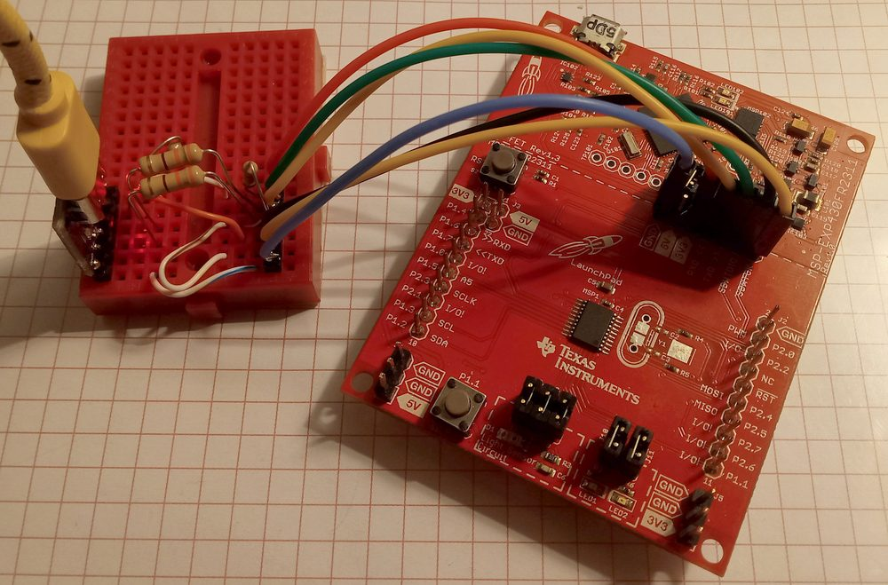
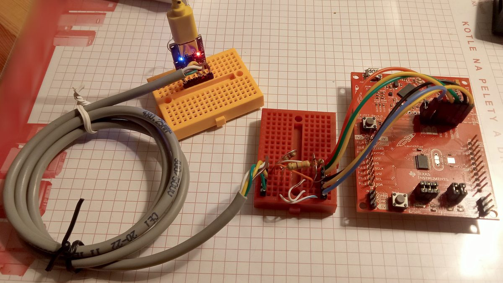

# Bench test: FRAM BSL and UART with TEST tied to RX (MSP430FR2311 LaunchPad)

Second step after [test_g2553](../test_g2553/README.md). The MSP-EXP430FR2311 has the same BSL
pins as the sensor board's FR2111 and they are the same JTAG pins: **P1.6 = RX = TDI, P1.7 = TX =
TDO**. Its hardware UART and the BSL packets (SLAU550) are the ones of `../fw` too.

**Result: passed with 3 wires and with 2 wires** (power-up not tested). Two things the G2553 didn't
show: the BSL needs a TEST low after RST rises, and over one wire a break after each BSL reply.
See [Results](#results-2026-11-25-ch340).

## FR2311 and FR2111

| | FR2311 (this test) | FR2111 (sensor board) |
|---|---|---|
| BSL version (SLAU550AB 7.1) | 00.08.35.B3 | 00.87.45.74 |
| Mass Erase 0x15, CRC Check 0x16, BSL version 0x19 | yes | **no** (table 4-9) |
| Wrong password erases everything | yes | yes |
| Blank chip starts the BSL by itself | **yes** | no |
| BSL goes to sleep after 10 s without communication | yes | not listed |
| BSL starts only after a TEST low following the RST rise (measured) | **yes** | not known |
| BSL pins, TEST pull-down 20–50k, SBW timing | same | same |

- `bsl_fr.py` and `../fw/tools/bsl.py` flash with password, write and read back only, what both
  chips have. Entry, reset, packets and one-wire handling are in `bsl.py`.
- **Entry:** after RST rises, TEST must go low once (any time, >= 1 ms tried) and high again. The
  G2553 needs the opposite: TEST must stay high (`Bsl.final_low`).
- A blank FR2311 makes a failed entry look like success, so `loop` checks before every entry
  that the app is running.
- A pass doesn't prove the FR2111's own BSL ROM.

- **One wire:** the BSL hears its own reply (hardware UART). The reply itself arrives intact, then the
  BSL answers its echo with 51h, hears that too, and floods the line for ever. A break of >= 3 ms
  after each reply stops it: `--onewire` sends 10 ms (`bsl_fr.py`: `--quench MS`). The app isn't concerned.

## LaunchPad

- J101: **remove RXD, TXD, SBW RST, SBW TST**. Keep 3V3 and GND: the board is powered
  from its own USB, plugged into a PC. 5V doesn't matter.
- **Remove J9** (connects P1.4 = TCK to GND). J7, J8 as you like. Keep J10, J11 (LEDs).
- **Adapter 3V3 not connected**, only GND and signals. Adapter set to 3.3 V levels.
- Plug in the LaunchPad first and unplug it last, otherwise the adapter feeds the chip through
  its inputs.

In the pictures (as tested) it was different: no cable in the LaunchPad's USB, so the chip runs from the
adapter's 3V3 (red wire; then the 3V3 jumper stays off), and J7–J9 are still fitted, so P1.4 (TCK) is at GND
through J9. It works that way too.

All signals are on the target side of J101 (the pins towards the MCU, even numbers), or on J1/J2:

| signal | J101 row | pin | or |
|--------|----------|-----|----|
| TEST | SBW TST | 2 | - |
| RST | SBW RST | 4 | J2-16 |
| P1.7 (TX) | TXD | 6 | J1-4 |
| P1.6 (RX) | RXD | 8 | J1-3 |
| 3V3 | 3V3 | 10 | J1-1 |
| GND | GND | 14 | J2-20 |

Already on the LaunchPad: RST 47k to 3V3 and 1 nF to GND, red LED P1.0, green LED P2.0.
Resistor names and values below are those of the sensor board.

## Schematic, 3 wires (TX, RX, RST)

Plus GND. Firmware `v1` / `v2`. Sensor board: JP2 open, JP3 bridged.



```
 USB-UART adapter                                         MSP-EXP430FR2311

                               3V3
                                |
                             [R7 4k7]
                                |
 TX  ------[ R5 330R ]----------+----------+-------------- J101-8  P1.6  BSL RX / UCA0RXD / TDI
                                           |
                                           +-------------- J101-2  TEST / SBWTCK


 RX  ------[ R6 330R ]------------------------------------ J101-6  P1.7  BSL TX / UCA0TXD / TDO

                               3V3
                                |
                             [R2 4k7]
                                |
 RTS ------[ R1 330R ]----------+------------------------- J101-4  RST / SBWTDIO

 GND ----------------------------------------------------- J101-14 GND

 3V3 not connected                          3V3 (R2, R7) = J101-10 or J1-1
```

## Schematic, 2 wires (TX/RX on one line, plus RST)

Plus GND. Firmware `ow`, tools with `--onewire`. Sensor board: JP2 closed, JP3 bridged, and an
open-drain host, here the adapter's push-pull TX behind a diode.



```
 USB-UART adapter                                         MSP-EXP430FR2311

                                          3V3
                                           |
                                        [R7 4k7]
                                           |
 RX  --+--- line H ---[ R5 330R ]--- M ----+----+--------- J101-8  P1.6  BSL RX / UCA0RXD / TDI
       |                                        |
       |                                        +--------- J101-2  TEST / SBWTCK
       |                                        |
       +--->|--- TX                             +--->|---- J101-6  P1.7  BSL TX / UCA0TXD / TDO
          D_host                                    D2
     cathode (band) at TX                      cathode (band) at P1.7

                               3V3
                                |
                             [R2 4k7]
                                |
 RTS ------[ R1 330R ]----------+------------------------- J101-4  RST / SBWTDIO

 GND ----------------------------------------------------- J101-14 GND

 3V3 not connected                          3V3 (R2, R7) = J101-10 or J1-1
```

- **Line H** is the cable: D_host's anode and adapter RX at its adapter end, R5 at the other.
- **Node M** joins R5, R7, P1.6, TEST and the anode of D2. Adapter RX is *not* on P1.7, R6 isn't used.
- Diodes: Schottky (BAT54, BAT85, 1N5819).
- R7 4k7 alone holds the line high against TEST's pull-down: 2.91 V typ, 2.67 V min (guaranteed
  high ~2.5 V). Without it the chip sees no high level.
- From 3 to 2 wires: adapter TX moves behind D_host, adapter RX from R6 to line H, add D2.

## Firmware

`make` builds `build/v1.hex` (slow blink), `build/v2.hex` (fast blink), `build/ow.hex` (version 3,
one wire: half duplex, checks its own bytes as they come back). Hardware UART UCA0 9600 8E1, clock
and 1 s watchdog as in `../fw`. Frames: list at the top of `main.c`. Red LED blinks, green LED
toggles with every good command.

## Danger

- A wrong password **erases the program**, the TI demo too: no backup without TI's tools
  (the demo can be downloaded from TI). Commands that send a password need the test app to answer,
  or `--first`. `probe` sends none.
- Nothing is written to the JTAG/BSL signatures (FF80–FF87): they can lock the chip.

## Steps

`PORT` = `/dev/ttyUSB0`. 3 wires:

| # | command | pass |
|---|---------|------|
| 1 | `bsl_fr.py PORT probe` (changes nothing) | "TEST low" variants 10/10 |
| 2 | `bsl_fr.py PORT flash build/v1.hex --first` (**erases the demo**) | erased blank, verify ok, boot frame, red LED blinks |
| 3 | `bsl_fr.py PORT probe` again, now with a known program | "TEST low" variants 10/10 |
| 4 | `host_fr.py PORT stress 1000`, then `cmd S` | no errors, no resets |
| 5 | `bsl_fr.py PORT flash build/v2.hex --old build/v1.hex`, then `stress 200` | version 2, fast blink |
| 6 | `bsl_fr.py PORT loop 100 build/v2.hex` | 0 failures, no stray bytes |
| 7 | `host_fr.py PORT rst-test`, `break`, `break 2000` | reset only with TEST low; break harmless |
| 8 | `host_fr.py PORT wdt-test` | app back after a watchdog reset with TEST high |
| 9 | `host_fr.py PORT power-test` | which help does the app need after power-up with TEST high? |
| 10 | `bsl_fr.py PORT info build/v2.hex` | which commands the BSL knows (informative) |

Then flash `ow.hex` (`--old build/v2.hex`) and rewire to 2 wires:

| # | command | pass |
|---|---------|------|
| 11 | `bsl_fr.py PORT probe --onewire` | "TEST low" variants 10/10: the BSL works on one line |
| 12 | `host_fr.py PORT stress 1000 --onewire`, then `cmd S --onewire` | no errors, own echo wrong 0 |
| 13 | `bsl_fr.py PORT loop 100 build/ow.hex --onewire` | 0 failures, no stray bytes |
| 14 | `bsl_fr.py PORT flash build/ow.hex --force --onewire` | erase, write, verify over one line |
| 15 | `host_fr.py PORT rst-test --onewire`, `break --onewire`, `wdt-test --onewire`, `power-test --onewire` | as steps 7–9 |

- "stray bytes": bytes from the BSL that nobody asked for, e.g. answers to its own echo.
- Break or step 15 may leave "own echo wrong" above 0: heartbeats sent while the line is held low.
- If step 1 or 3 is unreliable (it wasn't, J9 fitted or removed): P1.4 (J1-2) and P1.5 (J1-6) to 3V3 with 47k each. SLAU550 recommends
  it (TCK/TMS must not float), with 1 nF to GND each. Start without: the sensor board has none.
- `--rst dtr`: RST on DTR instead of RTS. `-v`: packet dump.

## Results (2026-11-25, CH340)

3 wires:

| # | result |
|---|--------|
| 1 | TEST low after RST: 4/4 each with 1, 5, 50 ms. TEST stays high: 0/4. Further (5 times each): low of 5 ms 5, 50 or 500 ms after RST, and 200 ms: all 5/5. Without the low the first packet is lost, packets 2-4 work 5/5 |
| 2 | pass: TI demo erased by a wrong password, F100-FFFF blank, same BSL session goes on, verify ok, app starts |
| 3 | as step 1, 10/10 with low, 0/10 without (known app in the chip) |
| 4 | pass: 1000 pings, 0 lost/wrong, 0 resets, no UART errors |
| 5 | pass: old password accepted, erased, v2 verified, 200 pings ok |
| 6 | pass: loop 100/100, no stray BSL bytes, no junk in front of boot frames |
| 7 | pass, 3x each: RST pulse ignored with TEST high, resets with TEST low. Break 0.2 s and 2 s: no reset |
| 8 | pass: back from the watchdog reset with TEST high 5/5 |
| 9 | not done |
| 10 | BSL 00.08.35.b3 (as in SLAU550), CRC Check supported, value ok |

So on the FR2311 P1.6 (TDI) and P1.7 (TDO) work as UART and BSL pins with TEST high. With J9 fitted TCK was
at GND during these tests, see below for TCK open. Series resistors 330R by their
colour bands, pull-up values and diode types not recorded.

2 wires:

| # | result |
|---|--------|
| 11 | entry pass: TEST low after RST 10/10 with 1, 5, 50 ms; TEST stays high 0/10. First reply good, then endless 51h |
| - | break after each reply, 30 packets each: 3, 5, 10, 20, 50 ms 30/30; 2 ms 22/30; 1 ms 14/30; 0.5 ms 10/30; none 15/30 |
| 12 | pass: 1000 pings between heartbeats, 0 lost/wrong, 0 collisions, 0 resets, own echo wrong 0 |
| 13 | pass: loop 100/100, no stray bytes (with the 10 ms break). Junk in front of every boot frame: 00h, the adapter hears its own reset break |
| 14 | pass 4 times: erase, blank check, write, verify over one line |
| 15 | pass: RST pulse ignored with TEST high, resets with TEST low (3x each); back from watchdog reset 5/5; break 0.2 s and 2 s no reset (2 s: own echo wrong 18 = two heartbeats). Power-up not done |

`../fw/tools/bsl.py` afterwards, with 2 wires and with 3 wires: up to date, forced (6x / 11x), other code
(3 wires: also without `--old`), wrong password, erase, flash of the blank chip: all pass. Regression:
loop 50/50 each, 100 / 500 pings, 0 errors.

**J9 removed** (TCK and TMS open), 3 wires: entry 60/60 with the TEST low (0/20 without, as always), loop
200/200, `bsl.py` forced flash 20/20, 1000 pings 0 errors, RST test 3x, watchdog 5/5, break 2 s: all pass.
Before that the chip had been power-cycled and reported cause brownout: it had started by itself (state of the
lines at that moment not known).

Once, right after rewiring, the MSP reset in the middle of a heartbeat (cause RST pin). Not
repeated in 6 further port openings and 4 RST pulses with TEST high. Not explained: with one wire
the MSP's own data pulls TEST low, so an RST glitch during a frame may reset it.

First attempts (same day) got no byte at all in 192 timing variants: wiring error.
