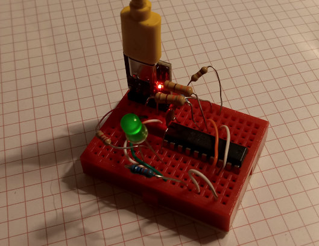
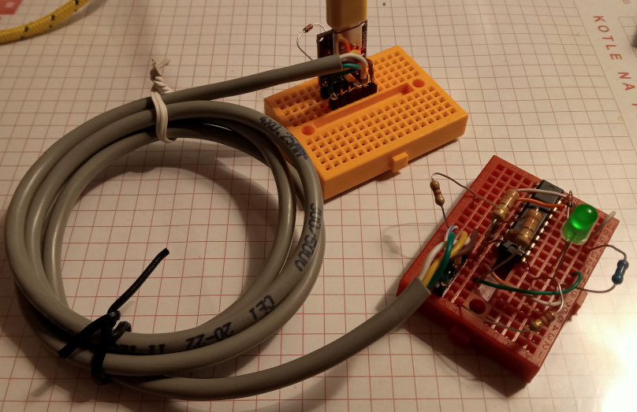

# Bench test: BSL entry and UART with TEST tied to RX (MSP430G2553)

Proves the principle of the keg20 sensor link before the PCB exists: TEST is tied to the
UART RX line, BSL entry = break pulses on that line + RST. The chip is a bare DIP-20 G2553
on a breadboard, the host is a 3.3 V USB-UART adapter (CH340) with one control line.
That line is **RTS**, although it was taken for DTR; `--rst dtr` selects the other one.

The G2553 BSL protocol differs from the FR2111 (SLAU319 vs SLAU550), so `bsl_g2.py` has its
own packets. `enter()` and `reset()` come from `../fw/tools/bsl.py`: that is the code under
test (with `final_low = None`: the G2553 needs TEST high after entry, the FR2xx a low). A pass doesn't prove the FR2111 packets, nor fully its P1.7 pin (TDO).

**Result: passed on the G2553**, with 3 wires and with one wire over a cable: BSL entry, flashing,
two-way UART and reset all work with TEST tied to RX. See [Results](#results-2026-11-24-g2553-ch340).

## Wiring, 3 wires (TX, RX, RST)

Plus GND and 3V3. Firmware `v1` / `v2`.



```
adapter TX  --[1k]--+-- 7   P1.5 (BSL RX, app RX, TMS)
                    +-- 17  TEST
                    +-- 9   P2.1 (probe input)
                    +--[47k]-- VCC
adapter RX  --[1k]----- 3   P1.1 (BSL TX, app TX)
adapter RTS --[1k]--+-- 16  RST      direct, not through a capacitor
                    +--[47k]-- VCC   no capacitor, max 1 nF
adapter 3V3 ----------- 1   VCC      100 nF to GND at the chip
adapter GND ----------- 20  GND
                        6   P1.4 --[47k]-- VCC    (TCK must not float)
                        15  P1.7 -- 8  P2.0       (TDO probe wire)
                        2   P1.0 --[470R]--|>|-- GND   LED
```

## Wiring, one wire (TX/RX on one line, plus RST)

Plus GND and 3V3. Firmware `ow`, tools with `--onewire`. This is the board's JP2 closed, with
the host side made open-drain by a diode (the adapter's TX is push-pull).



```
                                                VCC
                                                 |
                                             [R7 4k7]
                                                 |
adapter RX --+-- line H --[R5 330R]-- node M ----+--+-- 7   P1.5 (BSL RX, app RX, TMS)
             |                                      +-- 17  TEST
             |                                      +-- 9   P2.1 (probe input)
             |                                      |
adapter TX --|<|--+ (to line H)                     +--|>|-- 3   P1.1 (BSL TX, app TX)
           D_host                                       D2
        band to adapter TX                          band to pin 3

adapter RTS --[1k]--+-- 16  RST      as with 3 wires (board: R1 330R, R2 4k7)
                    +--[47k]-- VCC
adapter 3V3 ----------- 1   VCC      100 nF to GND at the chip
adapter GND ----------- 20  GND
                        6   P1.4 --[47k]-- VCC    (TCK must not float)
                        15  P1.7 -- 8  P2.0       (TDO probe wire)
                        2   P1.0 --[470R]--|>|-- GND   LED
```

- **Line H** is the cable: D_host's anode and adapter RX sit at its adapter end, R5 at the other.
- **Node M** joins R5, R7, pins 7, 17, 9 and the anode of D2. Adapter RX is *not* on pin 3.
- Diodes: Schottky (BAT54, BAT85, 1N5819). 1N4148 is borderline.
- **R7**: TEST has an internal pull-down (G2553 25-90k, FR2111 20-50k) and R7 alone holds the line
  high. A guaranteed high needs ~2.5 V. Calculated idle level of node M at 3.3 V, typ / min pull-down:

  | R7  | G2553 (60k / 25k) | FR2111 (35k / 20k) |
  |-----|-------------------|--------------------|
  | 47k | 1.85 / 1.15 V     | 1.41 / 0.99 V      |
  | 10k | 2.83 / 2.36 V     | 2.57 / 2.20 V      |
  | 4k7 | 3.06 / 2.78 V     | 2.91 / 2.67 V      |

- **R5** 330R (100R also works). With R7 4k7 and R5 1k the low level would be 0.65-0.81 V, close to
  the 0.82 V limit. Try R7 = 47k afterwards, to see if it really fails.

## Firmware

`make` builds `build/v1.hex` (slow blink), `build/v2.hex` (fast blink) and `build/ow.hex`
(version 3, one-wire: half duplex, ignores its own frames, waits for a free line). Software UART
9600 8E1 on the BSL pins, frames as in `../fw` (list at the top of `main.c`). BSLSKEY = 0.
Without factory calibration the app measures the baud rate from `0x80` bytes; the host
tools send them.

## Danger

The G2553 BSL unlocks info segment A. A mass erase, or a **wrong password** while word FFDE
is not 0, erases everything **including the DCO calibration**. `bsl_g2.py` has no mass erase
and needs `--first` before it sends a password to a chip with unknown content. `flash` and
`info` save the info memory to `backup/` when they can.

## Steps

| # | command | pass |
|---|---------|------|
| 1 | `bsl_g2.py PORT probe` (changes nothing) | BSL entered and synchronised |
| 2 | `bsl_g2.py PORT info --first` | chip ID 2553, BSL 0203 |
| 3 | `bsl_g2.py PORT flash build/v1.hex --first` | verify ok, app version 1, LED blinks |
| 4 | `host.py PORT stress 1000`, then `cmd J` | no errors, no resets |
| 5 | `bsl_g2.py PORT flash build/v2.hex --old build/v1.hex` | version 2, fast blink |
| 6 | `bsl_g2.py PORT loop 50` | 0 failures |
| 7 | `host.py PORT rst-test`, `host.py PORT break` | reset only with TEST low; break harmless |
| 8 | power cycle with TEST high, `host.py PORT monitor` | does the app start by itself? |

If step 1 fails: try `--rst dtr`, then `--rst manual` (RST by hand), then `--test dtr --rst manual`.

One wire (flash `ow.hex` over 3 wires first, then rewire):

| # | command | pass |
|---|---------|------|
| 9 | `host.py PORT stress 500 --onewire`, then `cmd J --onewire` | no errors, every echo correct |
| 10 | `host.py PORT rst-test --onewire`, `break --onewire` | as step 7 |
| 11 | `bsl_g2.py PORT probe --onewire`, `info build/ow.hex --onewire`, `loop 20 --onewire` | BSL works on one line |

## Results (2026-11-24, G2553, CH340)

| # | result |
|---|--------|
| 1 | pass, after two fixes: RST is on RTS (not DTR), and `enter()` must not end with TEST low |
| 2 | pass: chip ID 2553, BSL 0203. The old program's password was unknown, so the chip was erased, including the DCO calibration (no backup) |
| 3 | pass: verify ok, version 1, autobaud |
| 4 | pass: 1000 pings, 0 lost/wrong, 0 resets. Probe: P1.5 and P1.7 0 wrong of 65535, TEST high and low |
| 5 | pass: v2 runs, 200 pings ok; then back to v1 |
| 6 | pass: entry + sync 100/100, reset 50/50, loop 100/100. 9 boot frames had junk in front (BSL NAK / TX glitch) |
| 7 | pass: RST pulse ignored with TEST high, resets with TEST low; break 200 ms and 2 s don't reset |
| 8 | doesn't start by itself with TEST high: it needs a reset with TEST low (LED only, no closer look) |
| 9 | pass: 2000 pings between heartbeats, 0 errors, 0 collisions, 0 resets. Line echo with MSP in reset: 3600 bytes, 0 wrong. Probe 0 wrong of 65535, TEST high and low |
| 10 | pass: RST pulse ignored with TEST high and resets with TEST low (3x each); break 0.2 s and 2 s no reset |
| 11 | pass: BSL entry + sync, chip info, loop 100/100. `ow.hex` was flashed and verified over the one line (from v2) |

3 wires repeated later the same day (resistor values on the breadboard not recorded): flash v1 and
v2 ok, 1000 + 200 pings 0 lost/wrong, probe 0 wrong (49479 samples high, 289 low), break 0.2 s and
2 s no reset, RST pulse 3x ignored with TEST high and 3x reset with TEST low, loop 100/100
(10 boot frames with junk in front).

Wrong password with BSLSKEY = 0: two were sent before the right one when `ow.hex` was flashed,
nothing was erased.

Not covered: the FR2111 BSL packets and its P1.7 = TDO (the G2553's P1.7
works with TEST high, the probe wire was fitted).

One wire with the host talking at any time (`stress 1000 any`, after the tool fix): 17 collisions in 71 s,
2 wrong replies, 12 lost heartbeats. Not line errors: the CH340 hands over a received frame only after
its end, so the host can't see a running heartbeat. Avoid it by never sending unasked, or by sending only
between frames. The real sensor firmware only sends, its host only listens. An ESP sees every byte at once.
Resistor values and diode types on the breadboard: not recorded.

Cause of the first failure: the final 5 ms TEST low after RST rose was received by the BSL as
a byte. Sync got 90h in every try without it, at 1200-19200 baud, and none with it (1, 5, 100 ms).
